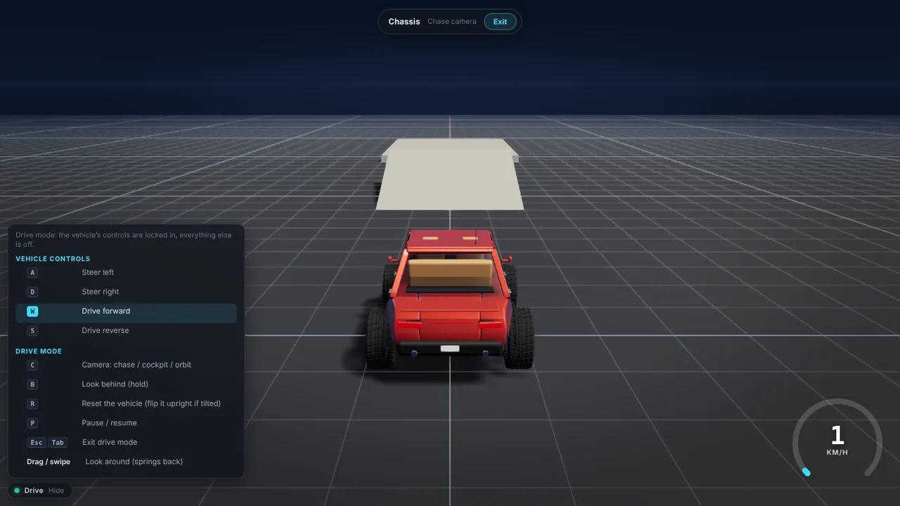
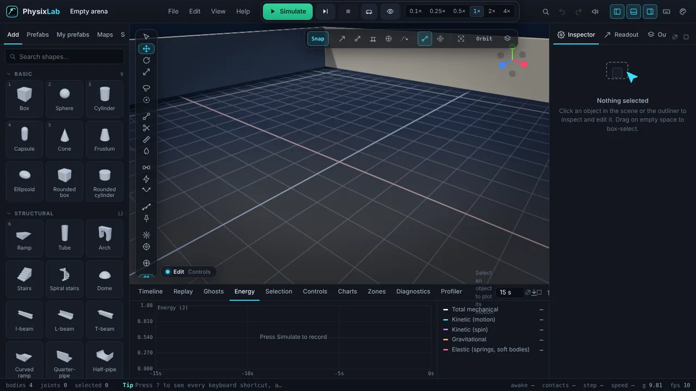
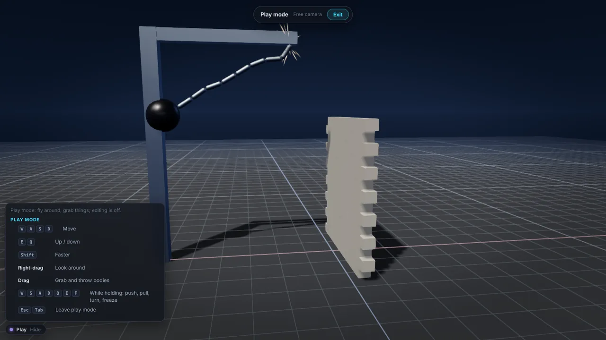
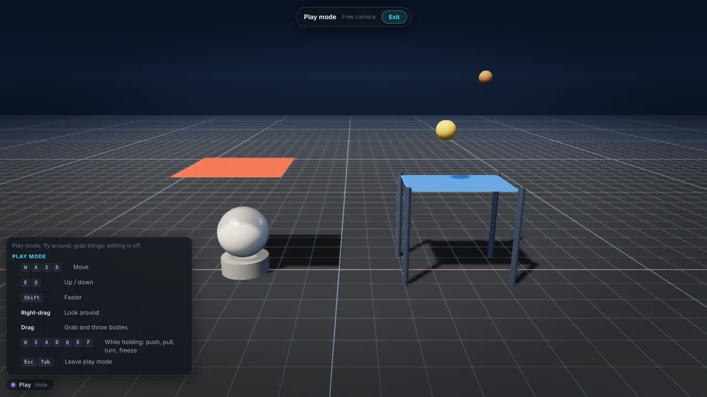
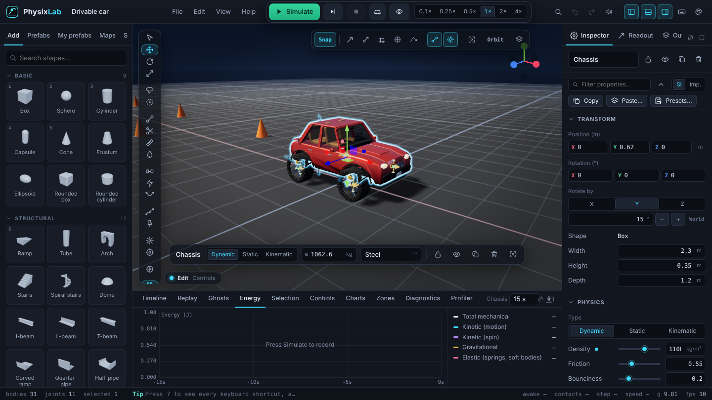
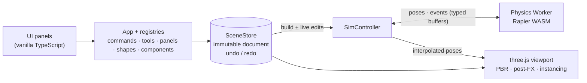

<div align="center">


<h1>PhysixLab</h1>

<p><b>Build mechanisms, vehicles and experiments, then watch them obey real physics.<br>
An advanced 3D physics sandbox that runs entirely in your browser.</b></p>

<br>

[](LICENSE)
[](tsconfig.json)
[](https://threejs.org)
[](https://rapier.rs)
[](https://vite.dev)
[](#-testing)
[](https://github.com/TheOriUHD/PhysixLab/actions)
[](#-run-it)
[](#-run-it)

[](https://github.com/TheOriUHD/PhysixLab/stargazers)
[](https://github.com/TheOriUHD/PhysixLab/network/members)
[](https://github.com/TheOriUHD/PhysixLab/issues)
[](https://github.com/TheOriUHD/PhysixLab/commits)

**[Run it](#-run-it)** &nbsp;·&nbsp; **[Features](#-features)** &nbsp;·&nbsp; **[Controls](#-controls)** &nbsp;·&nbsp; **[Architecture](#-architecture)** &nbsp;·&nbsp; **[Docs](#-documentation)** &nbsp;·&nbsp; **[Roadmap](#-roadmap)**

<br>



<sub>Drive mode on the bundled car — every joint, spring and motor in that car is a real, editable physics object.</sub>

</div>

<br>

## ✨ What is PhysixLab?

PhysixLab is a **build-it-and-watch-it-work 3D physics sandbox** that runs entirely in the browser — no server, no install, no account. Place shapes, connect them with joints, motors and springs, press **Simulate**, and then grab things, change gravity mid-run, rewind time, plot energy, or climb into the car and drive it.

It is built to be *physically honest*: [Rapier](https://rapier.rs) (Rust → WebAssembly) runs in a dedicated Web Worker with a fixed timestep, continuous collision detection and sleeping; mass comes from **density × volume** with real material densities; and the test-suite checks the engine against analytic results (free fall, pendulum and spring periods, Atwood machines, gear ratios, energy conservation…).

| | |
|---|---|
| 🧱 **A real construction workflow** | 39 parametric shapes, snapping, arrays, mirror, groups, user prefabs, full undo history, drag-from-palette with a live **ghost preview**. |
| ⚙️ **Real mechanisms** | 16 joint types, motors, servos, engines with gearboxes and differentials, hydraulics, thrusters — and joints that **break under load**. |
| 🧵 **Soft bodies** | Jelly, balloons, cloth, cables and tyres that deform, tear, can be cut and can be attached to rigid bodies. |
| ⏪ **Time travel** | Rewind, scrub, replay deterministically, compare ghosts of previous runs. |
| 🚗 **Drive mode** | Press **V**: chase camera, locked controls, gamepad and touch support. |
| 🔬 **A lab, not just a toy** | Live energy charts, FFT, per-object telemetry, force/contact overlays, adjustable time scale and gravity. |

<br>

## 🎬 See it in action

<table>
<tr>
<td width="50%" valign="top">

<br><b>Ghost placement</b><br><sub>Drag a tile into the scene and see exactly where it will land — with a drop line, landing ring and valid/invalid tint. One click arms it on a trackpad.</sub>
</td>
<td width="50%" valign="top">

<br><b>Constraints & impacts</b><br><sub>A wrecking ball on a jointed arm demolishes a tower: friction, restitution, continuous collision detection and sleeping all in play.</sub>
</td>
</tr>
<tr>
<td width="50%" valign="top">

<br><b>Soft bodies</b><br><sub>Particle-based cloth, jelly, cables and balloons — drag them with the mouse, pin them, tear them, cut them.</sub>
</td>
<td width="50%" valign="top">

<br><b>A proper editor</b><br><sub>Dockable panels, command palette (<kbd>Ctrl</kbd>/<kbd>⌘</kbd>+<kbd>K</kbd>), outliner, inspector with units, charts and timeline.</sub>
</td>
</tr>
</table>

> The animations above were recorded **from the app itself** with a deterministic frame-by-frame capture (the simulation is stepped a fixed amount per frame), so they show exactly what the engine computed. The app has the same capture built in — open the command palette (<kbd>Ctrl</kbd>/<kbd>⌘</kbd>+<kbd>K</kbd>) and run *Record video…*, *Record animated GIF…* or *Record turntable…*.

<br>

## 🚀 Run it

```bash
git clone https://github.com/TheOriUHD/PhysixLab.git
cd PhysixLab
npm install
npm run dev        # → http://localhost:5173
```

```bash
npm run build      # type-check + production build into dist/
npm run preview    # serve the production build
```

PhysixLab is a **fully static site** — `npm run build` produces `dist/`, which any static host can serve. It is also an installable **offline PWA**.

<details>
<summary><b>Hosting options</b></summary>

- **Cloudflare (Workers Builds)** — *Workers & Pages → Create → Import a repository*, pick the repo, build command `npm run build`, deploy command `npx wrangler deploy`. `wrangler.jsonc` already points at `dist/` (its `name` must match the Worker's name) and Node 22 is pinned by `.node-version`. Attach your domain under the Worker's *Settings → Domains & Routes → Add → Custom domain* (the domain must be a zone on your Cloudflare account); every push to the production branch redeploys. `public/_headers` sets the caching rules.
- **Netlify / Vercel** — import the repo (build command `npm run build`, output directory `dist`; `netlify.toml` already says so), or drag the built `dist/` folder onto [Netlify Drop](https://app.netlify.com/drop).
- **GitHub Pages** — `.github/workflows/pages.yml` is a manual workflow (*Settings → Pages → Source → GitHub Actions*, then run it from the Actions tab).
- **Embed it** — `?embed=1&scene=…` gives a minimal viewer you can put in an `<iframe>`; see [docs/EMBED.md](docs/EMBED.md).
- **Desktop** — install it as an app from the browser (PWA); wrapper notes are in [docs/DESKTOP.md](docs/DESKTOP.md).

</details>

**Requirements:** a modern browser with WebGL 2 and WebAssembly (Chrome, Edge, Firefox, Safari). Node 22+ to build.

<br>

## 🧰 Features

<details open>
<summary><b>🧱 Build</b></summary>

- **39 parametric shapes** in a searchable, categorised palette with generated thumbnails — box, sphere, cylinder, capsule, cone, wedge, prism, ellipsoid, **torus, ring, tube, arch, stairs, spiral stairs, dome, hemisphere, frustum, I/L/T beams, gear, wheel, curved ramps, quarter- and half-pipes, rounded shapes, pyramid and the five platonic solids, dice (d4 → d20)**. Hollow shapes are true compound colliders — a ball really falls through a torus.
- **Ghost placement**: drag a tile out of the palette (or click it, then click the scene) and watch a translucent preview snap onto surfaces; rotate with <kbd>Q</kbd>/<kbd>E</kbd>, lift with <kbd>[</kbd>/<kbd>]</kbd>.
- **Editing tools**: lasso/paint selection, align & distribute, mirror, linear/grid/radial/along-path **arrays**, pivot editing, snapping to grid/surfaces/vertices/edges, groups with transforms, copy/paste between scenes, **user prefabs** with thumbnails, spline paths.
- **Interaction tools**: grab and throw (with keyboard depth/rotation), blast variants, plane **cut tool**, paint, throw/aim with trajectory preview.
- Move / rotate / scale gizmos, numeric transforms, multi-select, lock/hide, **undo history panel** with jump-to-state.
- 50 example scenes and 34 insertable prefabs.

</details>

<details open>
<summary><b>⚙️ Mechanisms</b></summary>

- **16 joint types**: weld, hinge, slider, ball, spring, rope, **cone-twist, 6-DOF, pulley, rack & pinion, gear pair, belt/chain drive, universal (cardan), screw, winch, soft weld** — with limits, motors (velocity / position, force-capped, key- and axis-bound) and spring-dampers.
- **Breakable joints**: the engine exposes no constraint impulses for rigid joints, so PhysixLab estimates the load through the joint with a Newton–Euler momentum balance (exact for tree-like assemblies) — validated against statics in the tests. Joints can be given break thresholds, show a stress colour, and fatigue.
- **Powered parts** as components: engine with an editable torque curve, electric motor, servo, stepper, linear actuator, hydraulic cylinder, clutch, **gearbox, differential**, brakes, thrusters/rockets with fuel mass, jets and propellers/rotors.
- **Zones & race timing**: sensor volumes with 15 actions — checkpoints, finish lines (laps, splits), kill & respawn, teleporters, launch pads, gravity override, force fields, spawners, scoring, world bounds.
- Collision layers with a matrix editor, one-way platforms, quadratic drag, mass/COM overrides.

</details>

<details>
<summary><b>🧵 Soft bodies</b></summary>

- Jelly lattices, balloons (with pressure and punctures), cloth and cables from the engine's particle/constraint solver.
- **Attach** soft bodies to rigid bodies and joints (sails, nets, curtains, hanging weights), **cut** cloth, tear it with a strain threshold, generate **ropes and chains** that carry loads, build **pneumatic tyres** and a jelly car.
- Young's-modulus-style material display, elastic energy in the energy chart, budget & stability warnings.

</details>

<details>
<summary><b>🎥 Look & sound</b></summary>

- **40 material presets** with real densities and PBR values, procedural and image textures, normal/roughness/emissive maps.
- Physically based **sky with time of day**, environment presets and your own HDRI, fog, placeable point/spot/directional/area **lights**, weather (rain, snow, leaves).
- Post-processing stack — bloom, depth of field, motion blur, SSR, ambient occlusion, volumetric light shafts, grading — with **quality presets and an auto-governor**. Instanced rendering for scenes with many identical bodies.
- Shader-based **damage visuals**, a detailed car skin with spinning wheels and suspension compression, UI themes (dark, light, high-contrast, midnight, solarized, blueprint).
- **Particles** (sparks, dust, shards, smoke, explosions, skid marks) emitted from real contact impulses, and a fully **procedural audio engine** — material-aware impact sounds, rolling/sliding, engine tones, spatialised in 3D. No sample files.

</details>

<details>
<summary><b>⏪ Time, replay & analysis</b></summary>

- **Time travel**: full-state snapshots in a bounded ring buffer — hold <kbd>Backspace</kbd> to rewind, scrub a timeline with impact/break markers and bookmarks, step both directions.
- **Deterministic replays** (inputs + seed) you can save, share by link and re-verify bit for bit; **ghosts** of previous runs and A/B comparisons; seeded randomness everywhere; a determinism checker.
- Live **energy chart** (kinetic, rotational, potential, elastic), draggable multi-trace telemetry with **FFT**, velocity/force/contact overlays, joint **stress view**, adjustable time scale (0.05× – 4×), single-stepping.

</details>

<details>
<summary><b>🚗 Driving, cameras & input</b></summary>

- **Drive mode** (<kbd>V</kbd>) and **Play mode** (<kbd>Shift</kbd>+<kbd>V</kbd>): chase / cockpit / orbit cameras, locked controls, speedometer, on-screen key legend, reset & flip-upright.
- **Cameras**: orbit, fly, first/third person, chase, orthographic views, bookmarks, cinematic camera paths, split-screen and picture-in-picture, a live minimap.
- **OS-aware navigation**: trackpad (two-finger swipe, pinch-to-zoom, modifier pans), mouse and touch each get a scheme that works *without* needing to hold and scroll at once. A context-aware **controls legend** always shows which keys work right now.
- Gamepad (analog steering and throttle), touch controls with virtual sticks, mobile layout, fully **rebindable keys**.

</details>

<details>
<summary><b>🧩 Platform</b></summary>

- **Share** a scene as a compact link (the whole scene is compressed into the URL — no server), export JSON / glTF / OBJ / STL / PNG (up to 4K), or record **WebM / MP4 / GIF** and turntables.
- Local-first persistence with **restore points** and **crash recovery**, optional folder sync (File System Access API).
- **Peer-to-peer collaboration** over WebRTC (copy/paste signalling, or two tabs on one device).
- A typed **public API** (`window.physixlab`), a sandboxed **plugin** system (plugins add commands, panels and example scenes), **scripted scenes**, and a **headless CLI** for batch runs and parameter sweeps — see [docs/API.md](docs/API.md), [docs/PLUGINS.md](docs/PLUGINS.md), [docs/CLI.md](docs/CLI.md).
- Installable offline **PWA**; code-split bundles so the heavy features load on demand.

</details>

<details>
<summary><b>🧭 Workspace</b></summary>

- Dockable, resizable panels with saved layouts; command palette; floating inspector; **Simple / Advanced** mode; outliner with folders, drag-reparenting and filters.
- Inspector with SI/imperial toggles, math expressions in fields (`2*9.81`), scrub-drag labels, calculators, copy/paste properties.
- Presentation / photo mode, interactive tour, searchable shortcut cheat-sheet, friendly error handling with built-in diagnostics and a profiler.

</details>

<br>

## 🎮 Controls

| | Mouse | Trackpad (macOS &amp; others) | Touch |
|---|---|---|---|
| **Orbit** | Right-drag | Two-finger swipe · <kbd>⌥</kbd> + drag | One finger on empty space |
| **Pan** | Middle-drag | <kbd>⇧</kbd>/<kbd>⌘</kbd> + swipe · <kbd>Space</kbd> + drag | Two fingers |
| **Zoom** | Scroll (to cursor) | Pinch (to cursor) | Pinch |
| **Focus / frame all** | Double-click object / empty | same | Double-tap |

The scheme is **auto-detected** (and can be overridden in *Settings → Navigation*). Everything works on a trackpad alone — no gesture needs you to hold a button and scroll at the same time.

| Action | Keys |
|---|---|
| Add a shape | Click a tile, press <kbd>1</kbd>–<kbd>9</kbd>, or **drag it into the scene** |
| Move · rotate · scale · select | <kbd>W</kbd> · <kbd>E</kbd> · <kbd>R</kbd> · <kbd>Q</kbd> |
| Connect | <kbd>J</kbd>, click body A then body B |
| Simulate · step · stop | <kbd>Space</kbd> · <kbd>.</kbd> · <kbd>Shift</kbd>+<kbd>Space</kbd> |
| Grab & throw (while running) | Drag a body · <kbd>W</kbd>/<kbd>S</kbd> push/pull · <kbd>Q</kbd>/<kbd>E</kbd> turn · <kbd>F</kbd> freeze |
| Rewind | Hold <kbd>Backspace</kbd> |
| **Drive** the vehicle · **Play** mode | <kbd>V</kbd> · <kbd>Shift</kbd>+<kbd>V</kbd> |
| In Drive mode | <kbd>W</kbd><kbd>A</kbd><kbd>S</kbd><kbd>D</kbd> drive · <kbd>C</kbd> camera · <kbd>B</kbd> look behind · <kbd>R</kbd> reset · <kbd>Esc</kbd> exit |
| Command palette · all shortcuts | <kbd>Ctrl</kbd>/<kbd>⌘</kbd>+<kbd>K</kbd> · <kbd>?</kbd> |

<br>

## 🏗 Architecture



- **The document is the source of truth.** Scene data is plain, versioned JSON (with migrations); the worker builds a Rapier world from it and the renderer mirrors it.
- **Extend by adding files, not by editing shared ones.** Shapes, components, commands, tools, panels, templates, prefabs and maps are all *registered* with small typed registries — `docs/EXTENDING.md` has a tested example for each.
- **Physics runs identically in the worker and in Node**, so every physics feature is tested against the real engine.

<details>
<summary><b>Project layout</b></summary>

```
src/
├─ model/     scene document, shape & component registries, migrations, content (scenes, prefabs, maps)
├─ physics/   Rapier world (split into focused modules), worker, message protocol, components
├─ render/    three.js viewport, post-processing, effects, skins, gizmos, picking
├─ app/       wiring, input & navigation, editor commands, drive mode, placement, storage, capture
├─ ui/        panels, inspector, outliner, charts, palette, dialogs
├─ audio/     procedural WebAudio engine
└─ collab/    peer-to-peer collaboration
tests/        Vitest — runs the real Rapier engine in Node
e2e/          headless-Chromium tests that drive the real UI
docs/         architecture, extending guide, API, CLI, plugins, scripting, …
```

</details>

<br>

## 🧪 Testing

```bash
npm test               # 3,200+ unit & physics tests — the real Rapier engine, in Node
npm run test:e2e       # 300+ browser tests — real mouse, keyboard, touch and trackpad events in headless Chromium
npm run typecheck && npm run lint
```

The physics tests compare the engine to analytic results — free fall, momentum conservation, restitution, friction-angle thresholds, pendulum and spring-mass periods, motor torque and speed, gear ratios, Atwood machines, energy conservation, determinism of snapshot/restore — rather than just checking that nothing throws.

<br>

## 📚 Documentation

| | |
|---|---|
| [Architecture](docs/ARCHITECTURE.md) | How the pieces fit: document, worker protocol, registries, components |
| [Extending PhysixLab](docs/EXTENDING.md) | Add a shape / component / command / tool / panel / template / map — with tested examples |
| [Public API](docs/API.md) · [Plugins](docs/PLUGINS.md) · [Scripting](docs/SCRIPTING.md) · [CLI](docs/CLI.md) | Automate and extend |
| [Embedding](docs/EMBED.md) · [Collaboration](docs/COLLAB.md) · [Desktop](docs/DESKTOP.md) | Share and ship |
| [Performance](docs/PERFORMANCE.md) · [Limitations](docs/LIMITATIONS.md) | Numbers and honest caveats |
| [Feature checklists](docs/features) | Every feature, whether it is done, and the test that proves it |

<br>

## 🗺 Roadmap

PhysixLab is under active development. Done and shipping today: everything listed under **Features**. Next up (tracked in [`docs/features`](docs/features)):

- **Models & terrain** — GLB/OBJ/STL import with convex decomposition, compound-collider tools, extrude/revolve/boolean builders, heightfield terrain with sculpting
- **Logic & scripting** — sensors, a node-graph logic editor, sandboxed in-scene scripts, movers/conveyors/spawners
- **Fluids & fields** — buoyant water, particle liquids, sand, wind, gravity wells, magnets, aerodynamics, richer surface friction
- **Vehicles & characters** — raycast cars, tank, motorbike, boat, plane, helicopter, crane, excavator, walking robots, ragdolls
- **Destruction** — Voronoi shatter, pre-fractured objects, collapsing structures
- **Game layer** — challenges with budgets and stars, a campaign with tutorials, a classroom mode with lab worksheets
- **Maps** — a library of ready-made worlds and obstacles (race track, stunt park, pinball, mini golf, …)
- **Accessibility & localisation**, performance scaling to thousands of bodies, and more

<br>

## 🤝 Contributing

Issues and pull requests are welcome. Start with [docs/EXTENDING.md](docs/EXTENDING.md) — most contributions are *one new file plus one registration line* — and run `npm run typecheck && npm run lint && npm test` before opening a PR. Please keep changes honest: a feature is either genuinely implemented and tested, or it isn't in the UI. By contributing you agree that your contribution is licensed under the same terms as the project.

## 📄 License

PhysixLab is **source-available** under the [PolyForm Noncommercial License 1.0.0](LICENSE): free to read, run, modify and share for any **non-commercial** purpose — personal projects, learning, teaching, research and hobby use. Every copy or fork must keep the [license](LICENSE) and its `Required Notice` attribution line.

**Commercial use** — selling it, hosting it as a paid or ad-supported service, shipping it inside a commercial product — needs a separate licence. Get in touch via [@TheOriUHD](https://github.com/TheOriUHD).

© 2026 TheOriUHD

## 🙏 Built with

[**Rapier**](https://rapier.rs) by Dimforge (physics, compiled to WebAssembly) · [**three.js**](https://threejs.org) (rendering) · [**Vite**](https://vite.dev) · [**Vitest**](https://vitest.dev) · [**Playwright**](https://playwright.dev) (browser tests).

<div align="center"><sub>Made for people who want to see physics happen.</sub></div>
